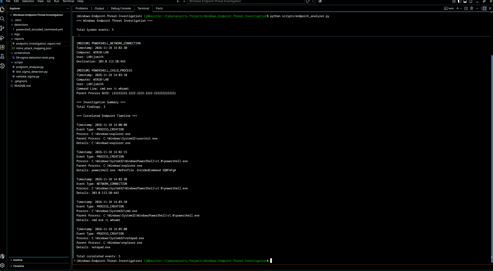
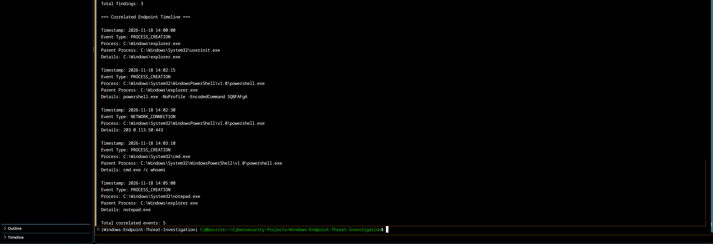
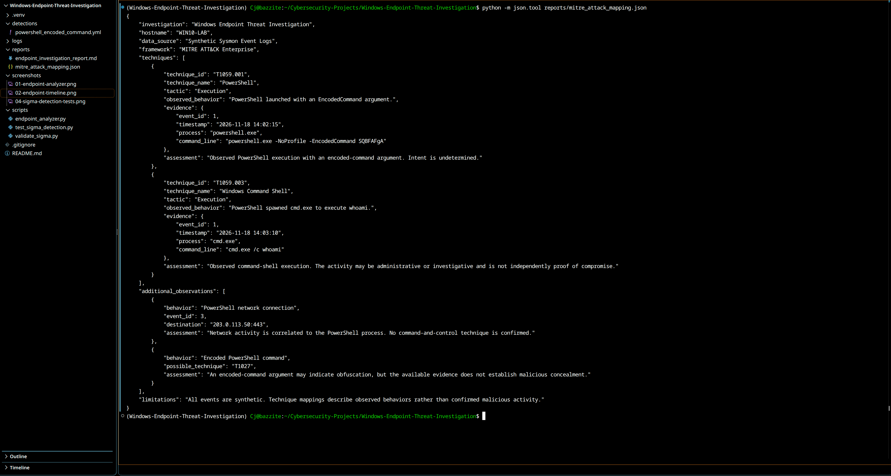
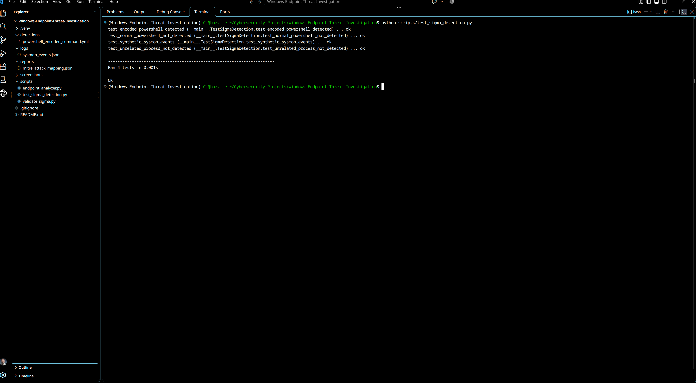

# Windows Endpoint Threat Investigation

**Python | Windows Sysmon | Endpoint Forensics | Sigma Rules | MITRE ATT&CK**

## Project Overview

This project simulates a Security Operations Center (SOC) investigation of suspicious Windows endpoint activity using synthetic Sysmon event logs.

The investigation focuses on encoded PowerShell execution, outbound network communications, and child-process creation. A Python-based analyzer identifies suspicious activity, reconstructs an endpoint timeline, and supports behavioral analysis.

A custom Sigma detection rule was developed and tested to identify PowerShell processes launched with encoded-command arguments.

All event data is synthetic. The findings demonstrate investigative and detection engineering techniques, not a confirmed real-world compromise.

## Objectives

- Analyze Windows Sysmon Event ID 1 (Process Creation) and Event ID 3 (Network Connection).
- Identify potentially suspicious PowerShell activity.
- Correlate process execution with network connections and child processes.
- Reconstruct a chronological endpoint investigation timeline.
- Map observed behaviors to MITRE ATT&CK.
- Develop and validate a Sigma detection rule.
- Test detection logic against suspicious and benign events.
- Document findings and investigation limitations.

## Tools and Technologies

| Tool | Purpose |
|---|---|
| Python | Event parsing, analysis, and correlation |
| Windows Sysmon event format | Endpoint telemetry analysis |
| pySigma | Sigma rule parsing and validation |
| Sigma YAML | Detection engineering |
| MITRE ATT&CK | Behavioral technique mapping |
| VS Code | Development and documentation |
| Bazzite Linux | Investigation environment |
| Git and GitHub | Version control and portfolio publication |

## Investigation Environment

- **Operating System:** Bazzite Linux
- **Programming Language:** Python 3.13
- **Data Source:** Synthetic Windows Sysmon events
- **Simulated Host:** WIN10-LAB
- **Simulated User:** LAB\jsmith
- **Events Analyzed:** 5
- **Suspicious Activity Findings:** 3

The project uses synthetic telemetry so that the investigation can be reproduced without deploying malware or requiring a Windows virtual machine.

## Investigation Findings

### Finding 1 — Encoded PowerShell Execution

**Severity:** High

**Timestamp:** 2026-11-18 14:02:15

**Process:** `powershell.exe`

**Command Line:**

```powershell
powershell.exe -NoProfile -EncodedCommand SQBFAFgA
```

The analyzer identified a PowerShell process launched with an encoded-command argument.

Encoded PowerShell commands may be used for legitimate administration or to obscure script contents. The available evidence does not establish malicious intent.

**MITRE ATT&CK:** T1059.001 — PowerShell

### Finding 2 — PowerShell Network Connection

**Severity:** Medium

**Timestamp:** 2026-11-18 14:02:30

**Destination:** `203.0.113.50:443`

**Protocol:** TCP

The Sysmon network connection event was associated with the PowerShell process observed in Finding 1.

The destination IP address belongs to a documentation-only address range used in the synthetic dataset.

The connection warrants investigation in the simulated scenario, but the available telemetry does not confirm command-and-control communication.

### Finding 3 — PowerShell Child-Process Execution

**Severity:** Medium

**Timestamp:** 2026-11-18 14:03:10

**Child Process:** `cmd.exe`

**Command Line:**

```cmd
cmd.exe /c whoami
```

The analyzer identified a command-shell process launched by PowerShell.

The command queries the current user context and may occur during legitimate administration or suspicious activity.

**MITRE ATT&CK:** T1059.003 — Windows Command Shell

## Endpoint Timeline

| Timestamp | Event | Observation |
|---|---|---|
| 14:00:00 | Process Creation | Windows Explorer process observed |
| 14:02:15 | Process Creation | Encoded PowerShell command |
| 14:02:30 | Network Connection | PowerShell connection to 203.0.113.50:443 |
| 14:03:10 | Process Creation | PowerShell launches cmd.exe |
| 14:05:00 | Process Creation | Notepad process observed |

The timeline illustrates how process creation and network telemetry can be correlated to investigate endpoint activity.

## MITRE ATT&CK Mapping

| Technique | Technique ID | Evidence |
|---|---|---|
| PowerShell | T1059.001 | PowerShell launched with an encoded-command argument |
| Windows Command Shell | T1059.003 | PowerShell spawned cmd.exe to execute whoami |
| Obfuscated Files or Information | T1027 | Possible association with encoded PowerShell execution; not confirmed |

The technique mappings describe observed behaviors and investigative hypotheses rather than confirmed adversary activity.

## Sigma Detection Engineering

A custom Sigma rule identifies PowerShell process creation events containing encoded-command arguments.

**Rule:** `detections/powershell_encoded_command.yml`

The rule includes:

- Windows process-creation log source
- PowerShell and PowerShell Core executable matching
- Encoded-command argument matching
- MITRE ATT&CK tags
- Potential false positives
- High severity classification

The rule was parsed and validated using pySigma.

### Automated Testing

Four automated tests verify the project's Sigma matching logic.

| Test | Result |
|---|---|
| Encoded PowerShell detected | PASS |
| Normal PowerShell not detected | PASS |
| Synthetic Sysmon event detected | PASS |
| Unrelated process not detected | PASS |

**Result: 4 tests passed.**

These tests validate the project's local detection logic against the supplied test cases; they do not establish compatibility with every SIEM backend.

## Evidence Screenshots

### 1. Endpoint Analyzer Results



### 2. Correlated Endpoint Timeline



### 3. MITRE ATT&CK Mapping



### 4. Sigma Detection Tests



## Repository Structure

```text
Windows-Endpoint-Threat-Investigation/
├── detections/
│   └── powershell_encoded_command.yml
├── logs/
│   └── sysmon_events.json
├── reports/
│   ├── endpoint_investigation_report.md
│   └── mitre_attack_mapping.json
├── screenshots/
│   ├── 01-endpoint-analyzer.png
│   ├── 02-endpoint-timeline.png
│   ├── 03-mitre-attack-mapping.png
│   └── 04-sigma-detection-tests.png
├── scripts/
│   ├── endpoint_analyzer.py
│   ├── test_sigma_detection.py
│   └── validate_sigma.py
├── .gitignore
└── README.md
```

## Running the Project

### Prerequisites

- Python 3.13
- Git
- pySigma

### 1. Clone the repository

```bash
git clone https://github.com/cmitch30/Windows-Endpoint-Threat-Investigation.git
cd Windows-Endpoint-Threat-Investigation
```

### 2. Create a Python environment

```bash
uv venv --python 3.13
source .venv/bin/activate
```

### 3. Install pySigma

```bash
uv pip install pysigma
```

### 4. Run the endpoint analyzer

```bash
python scripts/endpoint_analyzer.py
```

### 5. Validate the Sigma rule

```bash
python scripts/validate_sigma.py
```

### 6. Run automated tests

```bash
python scripts/test_sigma_detection.py
```

### 7. Review the investigation report

Open:

`reports/endpoint_investigation_report.md`

## Investigation Conclusion

The investigation identified three potentially suspicious activity patterns across five synthetic Windows Sysmon events.

The correlated activity included encoded PowerShell execution, an outbound network connection, and command-shell execution.

The investigation demonstrates endpoint telemetry analysis, behavioral correlation, MITRE ATT&CK mapping, Sigma detection development, and automated detection testing.

No confirmed malware infection, command-and-control activity, or endpoint compromise was established.

## Skills Demonstrated

- SOC alert triage and investigation
- Windows endpoint telemetry analysis
- Sysmon event interpretation
- Python security automation
- Process and network event correlation
- Threat detection engineering
- Sigma rule development
- MITRE ATT&CK mapping
- Automated detection testing
- Incident investigation documentation

## Disclaimer

This project uses synthetic security telemetry for educational and portfolio purposes. No real-world compromise or malicious infrastructure is represented.

## Author

**Clark Mitchell**

B.S. Cybersecurity and Information Assurance — Western Governors University (Expected March 2027)

CompTIA Security+ | CompTIA Network+ | CompTIA A+ | ITIL

[GitHub Profile](https://github.com/cmitch30)

[LinkedIn Profile](https://www.linkedin.com/in/clarkjmitchell/)